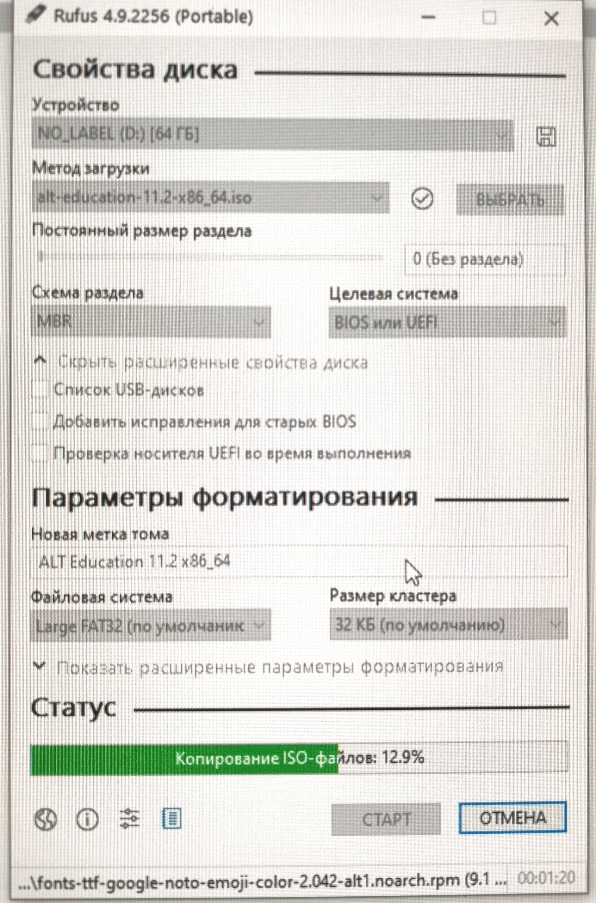
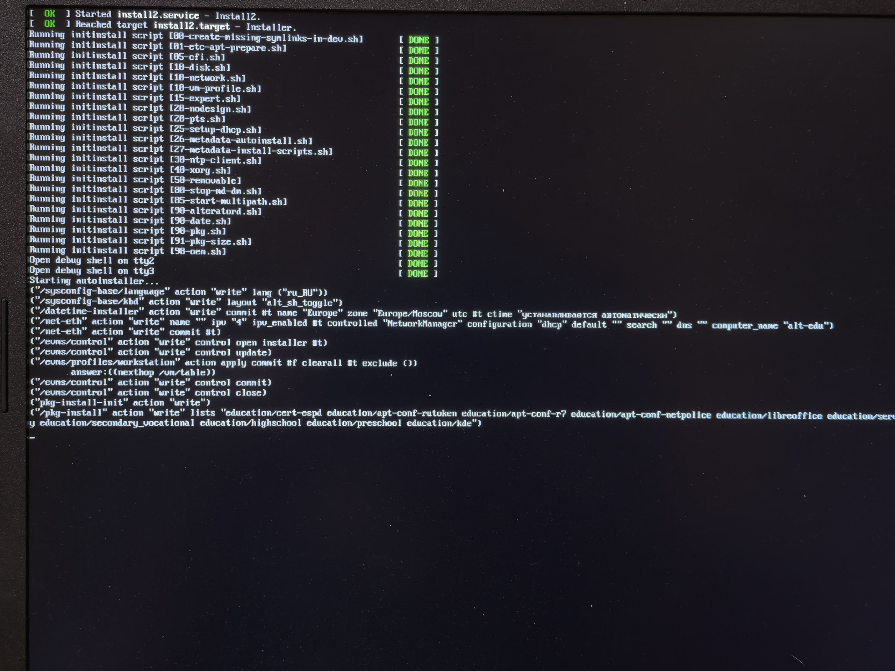

# Установка

1. Понадобится USB-флешка размером от 16GB;

2. Скачиваем оригинальный образ Альт Образование 11.2: https://www.basealt.ru/alt-education (размер ISO около 12GB);

3. Скачиваем rufus: https://rufus.ie/ru/

Образ необходимо записывать "как ISO" (не DD), чтобы была возможность добавлять файлы на флешку:

</img>

4. После записи качаем отсюда файлы и кладем на флешку:
   - `autoinstall.scm` → /Metadata/
   - `grub.cfg` → /boot/grub/

5. Скачать архив с RPM https://disk.yandex.ru/d/Pk6FsbTHn6e1Fw:
   - из архива извлечь папку `alt_offline`, скопировать в корень флешки. Скрипт `install_offline.sh` находится в ней и адаптирован для запуска по сценарию автоустановки;

6. На целевом компьютере:

   - в BIOS должна быть включена загрузка UEFI;
   - загрузится с флешки (обычно F12);
   - выбрать первый пункт **Установка ALT Education 11.2 x86_64**;
   - дождаться полной установки не отключать флешку — 20-30 минут.
   - процесс установки выглядит как-то так:
  
</img>

7. Успешность автоматической установки драйверов можно проверить в файле `/var/log/install_offline.log`;

8. RPM-пакеты после установки остаются в директории `/opt/alt_offline`.


# Что сделает автоустанвока

> [!TIP]
> Сценарий `autoinstall.scm` содержит ответы на установочные промпты (выбор языка, часовой пояс, разметка диска и т.д.) и его можно заранее отредактировать под свои нужды.

### Основные параметры установки:
- **Локализация**: переключение раскладки RU/US по сочетанию клавиш Alt + Shift, часовой пояс — Москва (Europe/Moscow).

- **Разметка диска**
  - ⚠️ все имеющиеся данные на диске будут уничтожены!
  - Загрузочный раздел EFI — 512 МБ.
  - Раздел подкачки SWAP — 8 ГБ.
  - Корневой раздел / — всё оставшееся пространство (файловая система Ext4).

- **Сеть**: автоматический поиск проводного сетевого интерфейса и настройка получения IP-адреса по DHCP.

- **Программное обеспечение**: установка полного набора дополнительных групп пакетов (Образование, Графика, Разработка, Офис и др.).

- **Учетные записи**:
  - Пользователь user: пароль user.
  - Администратор root: пароль Admin.
  - ⚠️ обязательно смените стандартные пароли после завершения установки.

### Действия после установки (Post-install):
- **Драйверы периферии**: копирование драйверов принтеров и сканеров с установочного носителя на системный диск с последующей офлайн-установкой их RPM-пакетов.

- **Имя компьютера**: автоматическое переименование хоста по шаблону alt-edu\<XXXXXX\>, где \<XXXXXX\> — последние 6 символов MAC-адреса сетевой карты.

---

### Периферия

Будет выполнена установка ПО и драйверов:
- КриптоПРО CSP
- Pantum BP5100DN
- Avision AV332U
- Fujitsu SP-1120


> [!NOTE]
> Офлайн-установка драйверов принтеров/сканеров и КриптоПРО создавалась на базе этого проекта: https://github.com/olegpecherkin/ege_alt_2026

---

# Разное

### Пересборка оригинального ISO-образа

```bash
xorriso -indev alt-education-11.2-x86_64.iso \
  -outdev alt-education-11.2-auto.iso \
  -boot_image any replay \
  -map autoinstall.scm /Metadata/autoinstall.scm \
  -map grub.cfg /boot/grub/grub.cfg \
  -map alt_offline /alt_offline
```

---

### Запись на флешку из консоли Linux
> [!WARNING]
> USB-накопитель может уйти в защиту от записи после dd. Но защита программная и ее можно снять, как пример через diskpart.

```bash
dd if=alt-education-11.2-auto.iso of=/dev/<флешка> bs=4m status=progress
```
